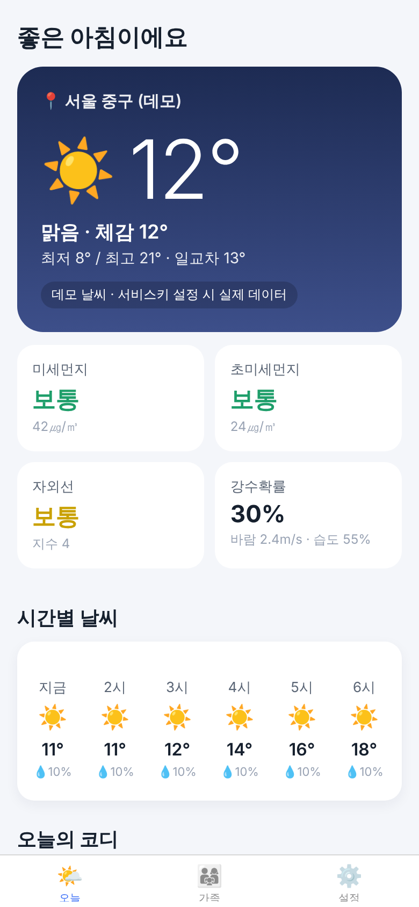
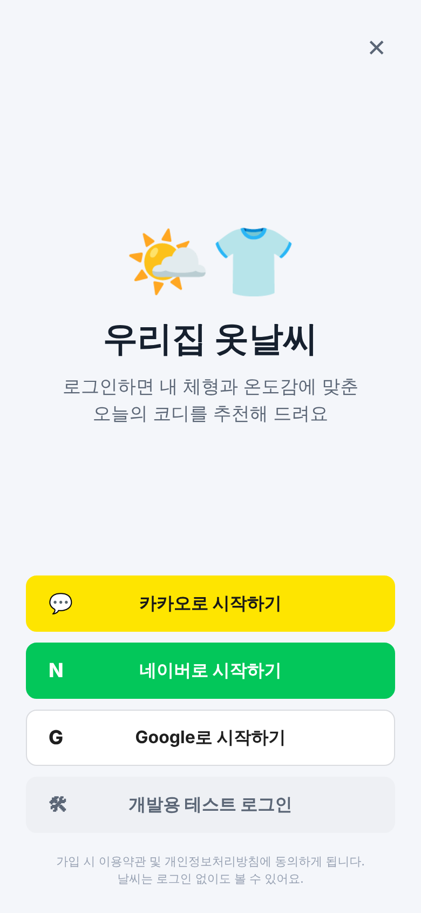
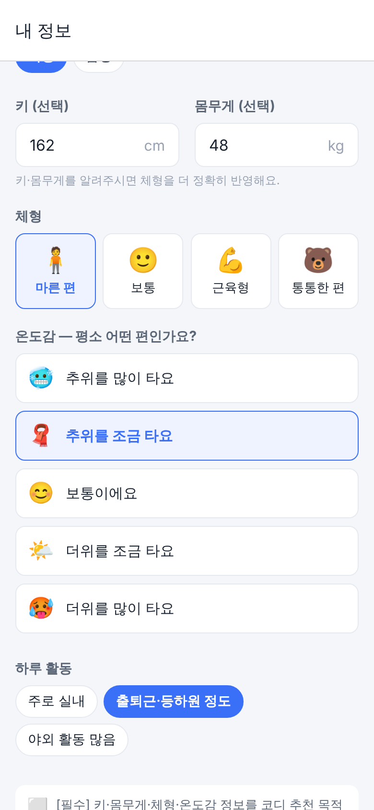
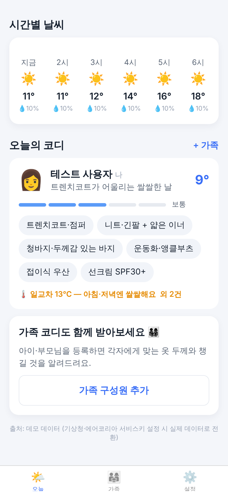
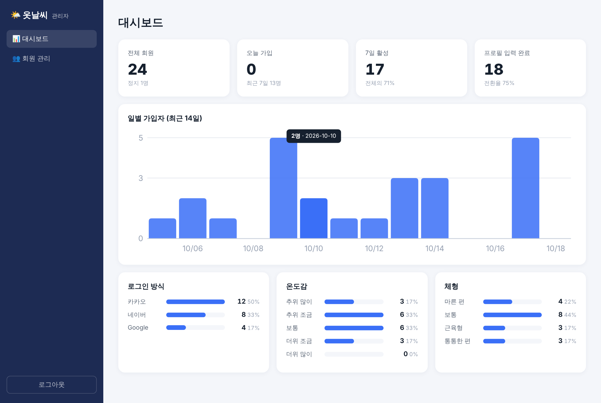
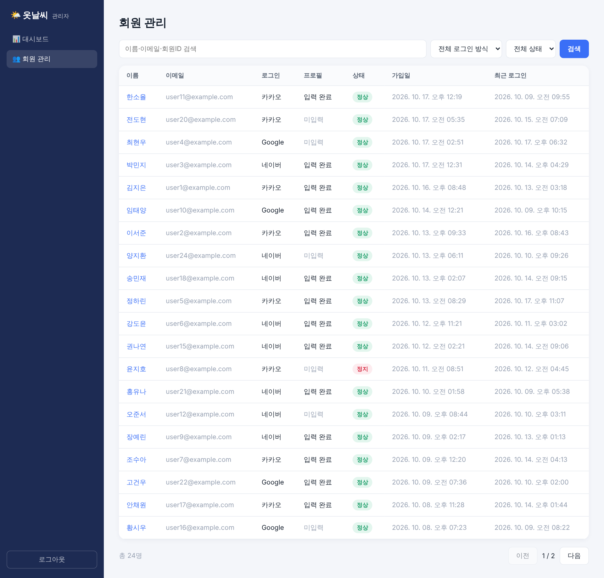
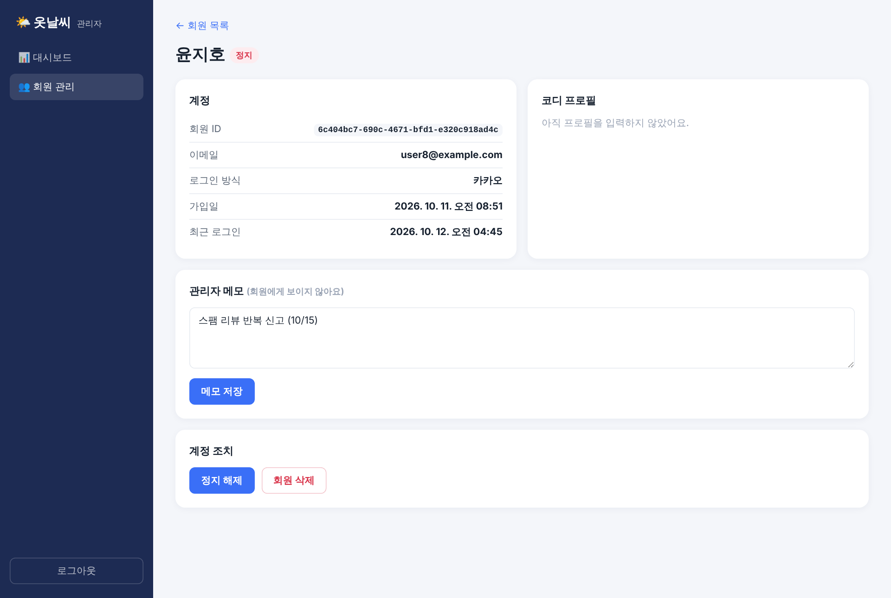

# 우리집 옷날씨 (가칭)

날씨를 보여주는 데 그치지 않고, 기온·강수·자외선·미세먼지·바람을 바탕으로 **나와 가족 구성원별(나이·키·몸무게·체형·추위/더위 민감도) 오늘의 옷차림**을 추천하는 안드로이드·iOS 앱입니다.

- **로그인 없이**: 날씨, 미세먼지, 자외선, 시간별 예보를 볼 수 있습니다.
- **로그인하면**: 키·몸무게·체형·온도감을 입력받아 **나에게 맞는 코디**를 추천하고, 가족 코디도 추가할 수 있습니다.
- **관리자 홈페이지**: 회원 통계, 회원 검색, 상세 조회, 이용 정지·해제, 메모, 삭제.

| 로그인 전 | 로그인 | 내 정보 입력 | 오늘의 코디 |
|---|---|---|---|
|  |  |  |  |

| 관리자: 대시보드 | 관리자: 회원 목록 | 관리자: 회원 상세 |
|---|---|---|
|  |  |  |

(관리자 화면 스크린샷의 회원은 모두 가짜 예시 데이터입니다.)

## 문서

- [00. 진행 기록](docs/00-progress-log.md): 지금까지 한 일, 현재 상태, 실행 방법, 다음 할 일
- [01. 시장·경쟁 조사](docs/01-market-research.md)
- [02. 서비스 기획서](docs/02-product-plan.md)
- [03. 실제 서비스 연결 가이드](docs/03-setup-keys.md): 공공데이터·카카오·네이버·구글 키 발급, GitHub 보안, 서버 배포
- [04. 앱 이름 후보](docs/04-naming.md)

## 폴더 구조

```
weather-outfit/
├─ app             # 안드로이드·iOS 앱 (Expo / React Native)
├─ admin           # 관리자 홈페이지 (React + Vite) → 서버가 /admin 주소로 서비스
├─ server          # API 서버 (날씨 데이터, 소셜 로그인, 회원 정보, 관리자 API)
└─ packages/core   # 코디 추천 엔진 (앱·서버 공용)
```

## PC에서 바로 보기 (설치 없이)

가장 쉬운 방법은 Claude가 올려 둔 **데모 미리보기 페이지**입니다. 휴대폰 화면 모양 안에서 앱이 실제로 동작하고(예시 날씨, 즉시 로그인), 코드를 고칠 때마다 Claude가 같은 주소로 다시 올립니다.

직접 만들려면 (Node.js 22 필요):

```bash
cd weather-outfit && npm install
npm run preview:demo        # 예시 날씨 · 즉시 로그인 → http://localhost:8090/frame
npm run preview:live        # PC 서버(localhost:4000)의 실제 날씨 · 테스트 로그인 → http://localhost:8090/frame
```

- `preview:demo`: 서버·키 없이 동작합니다. 로그인은 즉시 처리되고 입력 정보는 브라우저에만 저장됩니다.
- `preview:live`: 다른 터미널에서 `npm run dev:server`가 켜져 있어야 합니다. 실제 날씨와 "개발용 테스트 로그인"으로 앱 전체를 PC에서 확인할 수 있습니다.
- 위치 권한이 없는 PC 브라우저에서는 기본 지역(성남시 중원구 중앙동) 날씨를 보여줍니다.

## 최신 코드 받기 (Git)

처음 한 번:
```bash
git clone https://github.com/JungSunLee/JSL.git
cd JSL/weather-outfit
echo "DATA_GO_KR_SERVICE_KEY=내인증키" > server/env.local.txt   # 내 키 (git에 올라가지 않음)
npm install
```
이후 Claude가 수정해서 PR을 합친 뒤에는:
```bash
npm run update          # 최신 코드 받기 + 패키지 설치
```

## 내 휴대폰에서 앱 보기 (개발 중)

1. PC에 Node.js 22를 설치합니다.
2. 휴대폰에 **Expo Go** 앱을 설치합니다 (앱스토어/플레이스토어).
3. PC와 휴대폰을 **같은 와이파이**에 연결합니다.
4. PC에서 실행합니다:

```bash
cd weather-outfit
npm install

# 1) 서버 실행 (키가 없어도 데모 날씨 + 테스트 로그인으로 동작)
# server/.env.example 을 복사해 server/.env (또는 점 없이 server/env.txt) 로 만들고 키 입력
npm run dev:server                 # http://localhost:4000  (설정 파일을 자동으로 읽습니다)

# 2) 앱 실행 — <PC의 IP>는 PC의 와이파이 IP 주소 (예: 192.168.0.10)
EXPO_PUBLIC_API_URL=http://<PC의 IP>:4000 npm run dev:app
```

5. 화면에 나온 QR 코드를 휴대폰 카메라(iOS) 또는 Expo Go(안드로이드)로 찍으면 앱이 열립니다.
6. 코드를 고치면 휴대폰 화면이 바로 바뀝니다.

> 소셜 로그인 키가 없을 때는 로그인 화면의 **"개발용 테스트 로그인"**으로 로그인 이후 화면을 확인할 수 있습니다. 운영(NODE_ENV=production)에서는 자동으로 꺼집니다.

## 관리자 홈페이지

```bash
npm run build:admin     # 관리자 사이트 빌드
npm run dev:server      # http://localhost:4000/admin 접속
```

`server/.env`의 `ADMIN_EMAIL` / `ADMIN_PASSWORD`로 로그인합니다. 5회 연속으로 틀리면 10분간 잠깁니다.
개발 중에 화면만 고칠 때는 `npm run dev:admin`(http://localhost:5173/admin/)을 쓰면 수정 즉시 반영됩니다.

## 스토어 배포 (안드로이드·iOS)

앱은 EAS(Expo의 클라우드 빌드)로 빌드합니다. Mac이나 Android Studio가 없어도 됩니다.

```bash
cd app
npx eas-cli@latest login                 # Expo 계정
npx eas-cli@latest build --profile preview --platform android   # 테스트용 APK
npx eas-cli@latest build --profile production --platform all    # 스토어 제출용
npx eas-cli@latest submit --platform ios|android
```

배포 전에 해야 할 일:
- [ ] 서버를 인터넷에 배포하고 `app/eas.json`의 `EXPO_PUBLIC_API_URL`을 실제 주소(https)로 변경
- [ ] `app/app.json`의 `bundleIdentifier`/`package`(현재 `com.weatherfit.app`)를 회사 도메인으로 확정
- [ ] 앱 아이콘·스플래시 이미지 교체 (`app/assets`)
- [ ] **iOS: "Apple로 로그인" 추가 필요** — 카카오·네이버·구글 같은 소셜 로그인을 넣은 iOS 앱은 App Store 심사 가이드라인(4.8)에 따라 Apple 로그인 같은 동등한 로그인 옵션을 함께 제공해야 합니다. Apple 개발자 계정이 준비되면 추가합니다.
- [ ] 개인정보처리방침 URL, 14세 미만 법정대리인 동의, 건강 정보 처리 법률 검토

### 발급해야 할 키 (`server/.env`)

| 키 | 발급처 | 용도 |
|---|---|---|
| `DATA_GO_KR_SERVICE_KEY` | data.go.kr — 기상청 단기예보, 기상청 생활기상지수, 에어코리아 대기오염정보·측정소정보 활용신청 | 실제 날씨·자외선·미세먼지 |
| `KAKAO_REST_API_KEY` (+ `KAKAO_CLIENT_SECRET`) | developers.kakao.com — 카카오 로그인, Redirect URI `{PUBLIC_BASE_URL}/v1/auth/kakao/callback` | 로그인 + 지역명 |
| `NAVER_CLIENT_ID/SECRET` | developers.naver.com — 네이버 로그인, Callback URL `{PUBLIC_BASE_URL}/v1/auth/naver/callback` | 로그인 |
| `GOOGLE_CLIENT_ID/SECRET` | Google Cloud Console — OAuth 클라이언트(웹), 리디렉션 URI `{PUBLIC_BASE_URL}/v1/auth/google/callback` | 로그인 |
| `ADMIN_EMAIL` / `ADMIN_PASSWORD` | 직접 정함 (운영에서는 비밀번호 12자 이상) | 관리자 홈페이지 |

## 설계 메모

- **소셜 로그인은 서버가 대행**합니다. 앱은 브라우저 창만 열고 `weatherfit://auth#token=…`으로 돌아옵니다. 그래서 Expo Go에서도 동작하고, client secret이 앱에 들어가지 않습니다.
- **본인 프로필(키·몸무게·체형·온도감)은 서버에 저장**합니다. 동의를 받은 뒤에만 저장하고, 탈퇴하면 삭제합니다. 관리자가 조회할 수 있습니다.
- **가족 구성원과 건강 정보(질환·체온)는 기기에만 저장**합니다. 건강 정보는 민감정보이므로 별도 동의 후에만 입력받습니다.
- 관리자가 **이용 정지**하면 해당 회원은 앱 API를 쓸 수 없고 다시 로그인할 수도 없습니다.
- 회원·사용 로그는 SQLite(`server/data/app.db`, Node 내장)에 저장합니다. 사용자가 크게 늘면 같은 테이블 구조로 PostgreSQL로 옮길 수 있습니다.
- 사용 로그(`events` 테이블)는 화면 보기·버튼 누름만 기록하며 개인정보는 넣지 않습니다. 관리자 대시보드에서 DAU/WAU/MAU와 인기 버튼을 봅니다.

## 테스트

```bash
npm test          # 추천 엔진 30개 + 서버 19개
npm run typecheck
```
