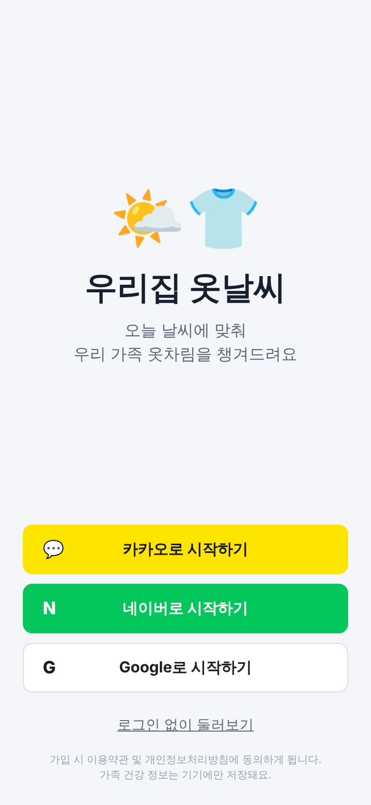
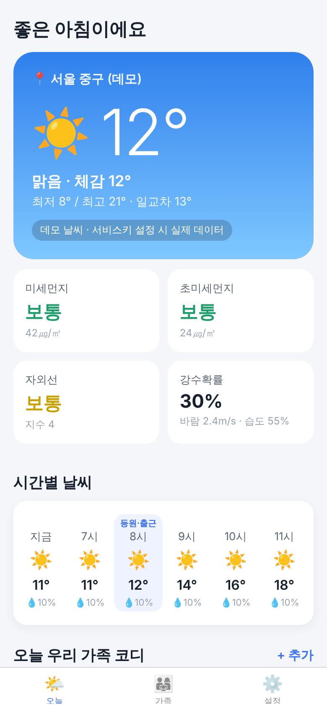
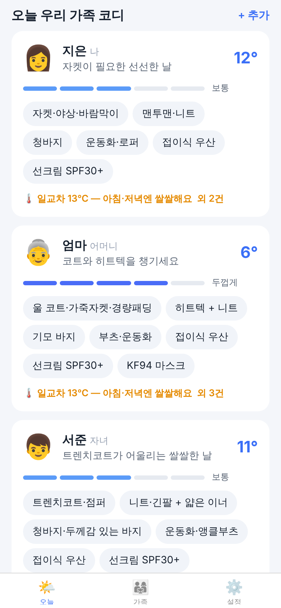
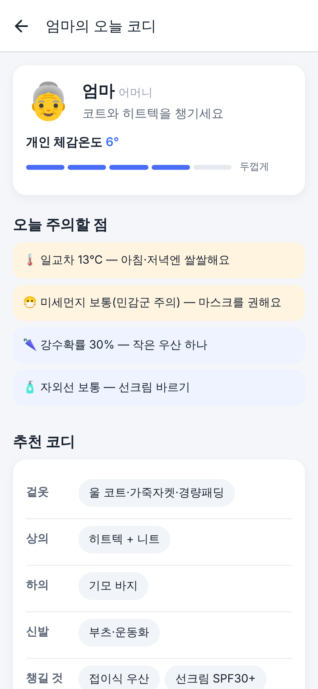

# 우리집 옷날씨 (가칭)

날씨를 보여주는 데 그치지 않고, 기온·강수·자외선·미세먼지·바람을 바탕으로 **가족 구성원별(나이·추위/더위 민감도·건강 상태) 오늘의 옷차림**을 추천하는 날씨 앱입니다.

| 로그인 | 오늘 | 가족 코디 | 구성원 상세 |
|---|---|---|---|
|  |  |  |  |

## 문서

- [01. 시장·경쟁 조사](docs/01-market-research.md): 국내외 날씨 앱 구성, 유사 서비스, 공공 API, 소셜 로그인·개인정보 메모
- [02. 서비스 기획서](docs/02-product-plan.md): MVP 범위, 화면 구성, 추천 로직, 건강앱 연동, 수익화·쇼핑 확장 로드맵

## 구조

```
weather-outfit/
├─ packages/core   # 공용 엔진 (TypeScript, 테스트 포함)
│                  #  - 위경도→기상청 격자, 발표시각 계산, 응답 정규화
│                  #  - 체감온도(기상청 산출식), 미세먼지·자외선 등급
│                  #  - 가족 구성원별 코디 추천 (recommend.ts)
├─ server          # Fastify API
│                  #  - GET /v1/weather?lat&lon : 기상청+생활기상지수+에어코리아+카카오 지역명 통합, 캐시
│                  #  - /v1/auth/{kakao|naver|google}/start|callback : 서버 대행 OAuth → 앱 딥링크로 JWT 전달
│                  #  - GET/DELETE /v1/me
└─ app             # Expo (React Native) 앱, expo-router
                   #  - 로그인 / 오늘 / 가족 / 설정 / 구성원 상세·편집
```

설계상 결정:
- **소셜 로그인은 서버가 OAuth를 대행**합니다. 앱은 브라우저 세션만 열고 `weatherfit://auth#token=…`으로 돌아옵니다. 그래서 Expo Go에서도 동작하고, 네이버·카카오·구글 client secret이 앱에 들어가지 않습니다. 복귀 주소는 allowlist로 검사하고(오픈 리다이렉트 방지), state는 서명된 JWT로 위조를 막습니다.
- **가족 프로필·건강 정보는 기기에만 저장**합니다. 건강 정보는 민감정보라 별도 동의 후에만 입력받고, 동의를 철회하면 즉시 삭제합니다.
- **공공 API 키가 없으면 데모 날씨**로 동작합니다. 부가 데이터(자외선·미세먼지·지역명)는 실패해도 날씨는 응답합니다.

## 실행

```bash
cd weather-outfit
npm install
npm test               # core + server 테스트

# 1) API 서버
cp server/.env.example server/.env   # 키 입력 (비워두면 데모 데이터)
set -a; . server/.env; set +a
npm run dev:server                   # http://localhost:4000

# 2) 앱
npm run dev:app                      # Expo Go로 QR 스캔, 또는 w 키로 웹
```

실기기에서 테스트할 때는 `EXPO_PUBLIC_API_URL=http://<PC의 LAN IP>:4000`를 설정하세요.

### 발급해야 할 키

| 키 | 발급처 | 용도 |
|---|---|---|
| `DATA_GO_KR_SERVICE_KEY` | data.go.kr. 기상청 단기예보, 기상청 생활기상지수, 에어코리아 대기오염정보·측정소정보 활용신청 | 날씨·자외선·미세먼지 |
| `KAKAO_REST_API_KEY` (+ `KAKAO_CLIENT_SECRET`) | developers.kakao.com. 카카오 로그인 활성화, Redirect URI `{PUBLIC_BASE_URL}/v1/auth/kakao/callback` | 로그인 + 좌표→지역명 |
| `NAVER_CLIENT_ID/SECRET` | developers.naver.com. 네이버 로그인, Callback URL `{PUBLIC_BASE_URL}/v1/auth/naver/callback` | 로그인 |
| `GOOGLE_CLIENT_ID/SECRET` | Google Cloud Console. OAuth 클라이언트(웹), 승인된 리디렉션 URI `{PUBLIC_BASE_URL}/v1/auth/google/callback` | 로그인 |

## 다음 단계

- [ ] 사용자 DB(PostgreSQL) 전환. 지금은 MVP용 JSON 파일 저장소
- [ ] 로그인 사용자 가족 프로필 서버 동기화 (건강정보 제외 또는 암호화)
- [ ] 아침 알림 푸시 ("오늘 서준이는 장화 신겨요")
- [ ] "추웠어요/더웠어요" 피드백 → 개인 보정 학습
- [ ] HealthKit / Health Connect 체온 연동 (EAS 개발 빌드)
- [ ] 쇼핑 연결: `OutfitItem.category` → 제휴 상품 매핑
- [ ] 중기예보(주간) 추가, 위젯
- [ ] 상표 검색, 개인정보처리방침·법정대리인 동의 법률 검토
